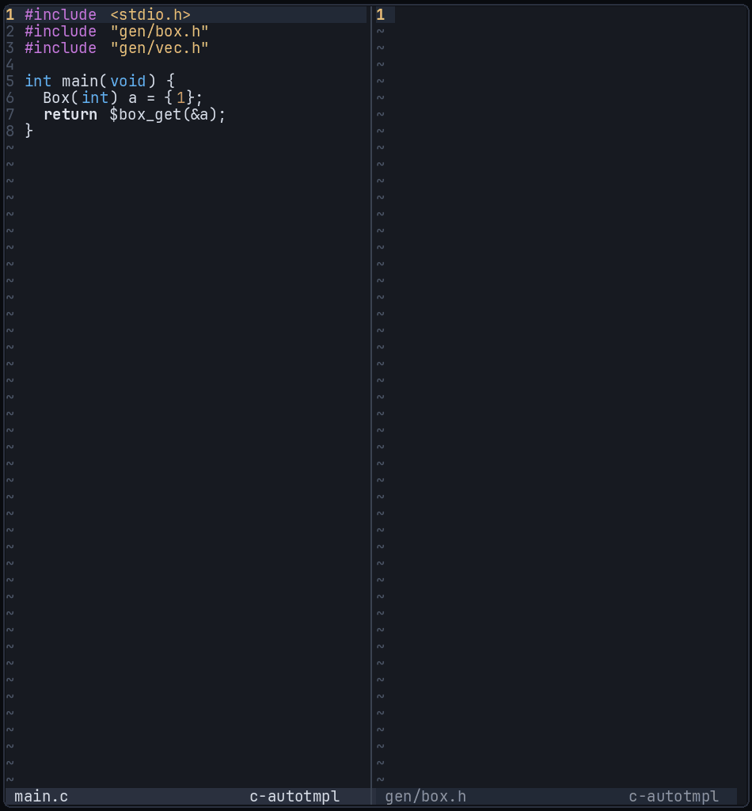

<p align="center">
  <h1 align="center">c-autotmpl</h1>
  <p align="center">C template-style generic headers, generated from your editor or your build. Parametric polymorphism, ad-hoc overloading, and compile-time generic calls in plain C.</p>
</p>

<p align="center">
  <a href="LICENSE.md"></a>
  <a href="https://github.com/elias-michaias/c-autotmpl/actions/workflows/cli-build.yml"></a>
</p>

<p align="center">
  <a href="#what-you-get">What you get</a> &bull;
  <a href="#use-it">Use it</a> &bull;
  <a href="#generic-calls">Generic calls</a> &bull;
  <a href="#ad-hoc-overloading-and-explicit-method-types">Ad-hoc overloading</a> &bull;
  <a href="#configuration">Configuration</a> &bull;
  <a href="doc/USAGE.md">Usage</a> &bull;
  <a href="doc/USAGE.md#stc-quick-start">STC quick start</a>
</p>

---

<p align="center">
  
</p>

c-autotmpl writes the generated headers behind C template-style code such as
`List(int)` or `Box(Point)`. It runs as a single-file ISO C99 CLI for builds or as
a clangd plugin that keeps headers current while you type. Both read the same
[project configuration](#configuration).

## What you get

- **Genericity in plain C.** Declare `List(T)` once; use `List(int)`,
  `List(Box(int))`, or deeper chains without hand-written macro blocks.
- **Generic calls.** `$vec_push(&xs, 7)` selects the concrete operation from its
  arguments at compile time, with one spelling for every instantiation.
- **Ad-hoc overloading.** Unrelated templates can own the same operation name;
  `map` can dispatch to both `Option.map` and `Result.map`.
- **Explicit type arguments.** `map(float)(r, f)` supplies an output type at the
  call site while the owner template is inferred from `r`.
- **Two generators, one configuration.** The portable CLI drives builds; the
  clangd plugin generates from unsaved buffers and improves editor navigation.
- **[STC](https://github.com/stclib/STC) adapters.** Write `vec(int)` and call
  `vec_push(int)(&nums, 7)` or `$vec_push(&nums, 7)`.

## Use it

### CLI

```sh
cc -std=c99 -O2 src/cli/autotmpl.c -o autotmpl
./autotmpl --root . --dry-run --verbose src/main.c
```

Copy `src/cli/autotmpl.c` anywhere and compile it. Prebuilt binaries are
published by GitHub Actions. See [BUILD.md](doc/BUILD.md) for the Makefile and
Windows builds.

### clangd plugin

```sh
make LLVM_SRC=/path/to/llvm-project LLVM_BUILD=/path/to/llvm-project/build
clangd --load=/absolute/path/to/build/libc-autotmpl.so
```

For most editors, `--load` is the only setup. The plugin writes missing headers
before clangd parses a file, prunes unused blocks after its workspace scan, and
routes generic calls to their template declarations. See
[BUILD.md](doc/BUILD.md) for the matching LLVM tree and plugin details.

<a id="at-a-glance"></a>

### One-minute example

```c
#include "gen/box.h"
#include "gen/vec.h"
#include "gen/dispatch.h" /* after instantiations, before generic calls */

Box(int) box = {3};
vec(int) xs = {0};

$box_free(&box);      /* calls box_free_int */
$vec_push(&xs, 7);    /* calls vec_int_push */
```

Generated instantiation headers come first, then the dispatch header, then call
sites. Concrete implementations stay separate while one call spelling resolves
at compile time. A template header is a decorator plus the usual preprocessor
pattern; see [what the pattern does](doc/USAGE.md#what-the-pattern-does).

## Configuration

Project settings live in `autotmpl.conf` at the workspace root. CLI flags
override the file, the file overrides environment variables, and environment
variables override defaults. Restart clangd after changing the file.

```text
# autotmpl.conf
dispatch=1
dispatch_templates=vec,pair
# dispatch_truncate=1
```

Common keys:

| Config key | Environment variable | Effect |
| --- | --- | --- |
| `dispatch` | `C_AUTOTMPL_DISPATCH` | Enable compile-time generic calls. |
| `dispatch_templates` | `C_AUTOTMPL_DISPATCH_TEMPLATES` | Comma-separated templates that get generic calls. |
| `dispatch_truncate` | `C_AUTOTMPL_DISPATCH_TRUNCATE` | Use bare operation macros and direct targets; ignore the affix. |
| `preprocess` | `C_AUTOTMPL_PREPROCESS` | CLI only: scan expanded source so macro-generated usages are visible. |
| `preprocess_backend` | `C_AUTOTMPL_PREPROCESS_BACKEND` | `local` internal expander or `full` batched `cc -E -P`. |
| n/a | `C_AUTOTMPL_ROOT` | Force the clangd plugin workspace root. |

The full key list, profiles, and preprocessing backends are in
[Configuration](doc/USAGE.md#configuration).

## How generation works

A template header carries a decorator:

```c
// -- template List(T)
#define List_IMPL(T) List_##T
#define List(T) List_IMPL(T)
/* ... */
```

For a use of `List(float)`, c-autotmpl appends a marked, guarded re-include block
that defines `T`, includes the template header, and undefines `T`. The marker
drives idempotency and pruning; the presence macro prevents duplicate definitions
across generated headers. User-defined types need a traditional include guard
such as `FOO_H`; builtin and fixed-width scalars are emitted bare.

Generic-call discovery can also expand a template header itself with
`// -- preprocess` or `dispatch_preprocess_headers`. A shared header may carry
several decorators; each marked section is emitted inline with its preamble.
Generated dispatch is consolidated the same way: owner sections contribute
guarded selector tables to `gen/dispatch.h`, and shared sections define one
public spelling even when several templates own the operation.

Authoring details: [nested types](doc/USAGE.md#nested-types),
[split implementations](doc/USAGE.md#split-implementations),
[function templates](doc/USAGE.md#function-templates),
[value generics](doc/USAGE.md#value-generics), and
[lexical HKTs](doc/USAGE.md#lexical-hkts).

## Generic calls

With `dispatch=1`, generated operations get one method-style spelling for every
instantiation. Include the generated instantiation headers first, then
`gen/dispatch.h`, then the calls:

```c
vec(int) xs = {0};
vec(float) ys = {0};

$vec_push(&xs, 7);      /* vec_int_push */
$vec_push(&ys, 2.5f);   /* vec_float_push */
$vec_at(2, xs);         /* vec_int_at, value as the second argument */
```

A type-template header contributes an operation when a function declaration's
parameter list mentions its template call form (`vec(int)`, `Box(T)`,
`pair(Key, Value)`) or a template parameter/decorator (`T`, `U`, `i_type`). The
function name is not compared with the template name, and declarations after
`#ifndef TMPL_HEADER` stay private.

Set `dispatch_truncate=1` for **bare generic calls** such as
`box_set(&box, 7)`. Declare the operation as `box_set_impl(T)` in the template
header; the dispatcher exposes `box_set` and targets `box_set_<Type>`.
`dispatch_affix` is ignored in this mode. See
[Bare generic calls](doc/USAGE.md#bare-generic-calls) for a complete example.

The default backend is C11 `_Generic`; `dispatch_backend=builtin` uses compiler
builtins for C99. `dispatch_style=prefix|postfix` and `dispatch_affix` control the
public spelling. See [Generic calls](doc/USAGE.md#generic-calls) for selection,
naming, forwarding, and ownership rules.

## Ad-hoc overloading and explicit method types

With `dispatch=1` and `dispatch_truncate=1`, one generated function name can
serve unrelated templates. Concrete names are pasted from template arguments, so
two owners with the same argument list would collide. `// -- +owner` (or
`// -- mangle +owner`) opts a template section into owner-qualified targets: the
owning template name becomes the final paste component. It is opt-in, and public
call spelling is unchanged. List the owners in `dispatch_templates` so they
contribute to the shared dispatch header.

For ordinary operations, no extra implementation parameter is needed:

```c
/* tmpl/box.h */
// -- template type Box(T)
// -- +owner
#define BOX_CAT2_I(a, b) a##b
#define BOX_CAT2(a, b) BOX_CAT2_I(a, b)
#define BOX_CAT3_I(a, b, c) a##_##b##_##c
#define BOX_CAT3(a, b, c) BOX_CAT3_I(a, b, c)
#define Box(T) BOX_CAT2(Box_, T)
#define get_impl(T, Owner) BOX_CAT3(get, T, Owner)
typedef struct { T value; } Box(T);
static inline T get_impl(T, Owner)(Box(T) *b) { return b->value; }
#undef get_impl
```

A `Container(float)` section using `// -- mangle +owner` has the same shape.
Even though both templates take one argument, the calls stay distinct:

```c
Box(int) b = {7};
Container(float) c = {2.5f};

int x = get(&b);    /* get_int_Box */
float y = get(&c);  /* get_float_Container */
```

The decorator also composes with a curried method that has explicit type
arguments. Add a trailing synthetic `Owner` parameter to the implementation
declaration and paste macro; callers do not supply it:

```c
/* tmpl/option.h */
// -- template type Option(T)
// -- template function option_map_impl(T, U, Owner)
// -- dispatch method Option.map explicit U
// -- +owner
#define OPTION_CAT2_I(a, b) a##b
#define OPTION_CAT2(a, b) OPTION_CAT2_I(a, b)
#define OPTION_CAT4_I(a, b, c, d) a##_##b##_##c##_##d
#define OPTION_CAT4(a, b, c, d) OPTION_CAT4_I(a, b, c, d)
#define Option(T) OPTION_CAT2(Option_, T)
#define option_map_impl(T, U, Owner) OPTION_CAT4(map, T, U, Owner)
typedef struct { int has; T value; } Option(T);
static inline Option(U) option_map_impl(T, U, Owner)(Option(T) value,
                                                     U (*f)(T)) {
  Option(U) out = {0};
  if (value.has) { out.has = 1; out.value = f(value.value); }
  return out;
}
#undef option_map_impl
```

```c
/* main.c */
#include "gen/box.h"
#include "gen/container.h"
#include "gen/option.h"
#include "gen/dispatch.h"

static int twice(int x) { return 2 * x; }

int main(void) {
  Box(int) b = {7};
  Container(float) c = {2.5f};
  Option(int) o = {1, 7};

  int x = get(&b);                            /* get_int_Box */
  float y = get(&c);                          /* get_float_Container */
  Option(int) oi = map(int)(o, twice);        /* map_int_int_Option */
  return x == 7 && y == 2.5f && oi.value == 14 ? 0 : 1;
}
```

The concrete target is `<op>_<owner args>_<explicit args>_<Owner>`. The curried
argument supplies the output type; `_Generic` on the first value argument selects
the owner. See
[Curried methods with explicit type arguments](doc/USAGE.md#curried-methods-with-explicit-type-arguments)
for the full rules and a two-owner `Option`/`Result` example.

## STC with thin adapters

STC support is opt-in. A wrapper needs one decorator and one paste macro; the
generated header adds configuration and thin adapters from the operations used
in your sources:

```c
vec(int) nums = {0};
vec_push(int)(&nums, 7);
```

STC can be selected by auto-detection or an explicit template list; see
[Configuration](#configuration). Adapters come from current call sites, so a new
operation works without a generator update. Start with the
[STC quick start](doc/USAGE.md#stc-quick-start).

## Documentation

| Document | Description |
| --- | --- |
| [**Usage guide**](doc/USAGE.md) | CLI, configuration, template authoring, guards, generated files, generic calls, STC, and plugin behavior. |
| [**Generic calls**](doc/USAGE.md#generic-calls) | Compile-time operation selection, naming, forwarding, and ownership. |
| [**STC quick start**](doc/USAGE.md#stc-quick-start) | Thin adapters, auto-detection, explicit template lists, and traits. |
| [**Polymorphism**](doc/POLYMORPHISM.md) | Constraints, function templates, ad-hoc overloading, tagged unions, and trait impls. |
| [**Build guide**](doc/BUILD.md) | CLI build, clangd plugin build, loading, tests, and build errors. |
| [**Performance**](doc/PERFORMANCE.md) | Benchmark methodology, configuration costs, and sample results. |
| [**Troubleshooting**](doc/TROUBLESHOOTING.md) | Common failures and fixes. |

## Build and test

```sh
make
make install
make test
make bench
```

The plugin build needs a matching LLVM source and build tree; the CLI does not.
`make install` puts the CLI at `~/.local/bin/autotmpl` and the plugin at
`~/.local/lib/c-autotmpl/libc-autotmpl.so`. Restart clangd after replacing the
plugin. See [BUILD.md](doc/BUILD.md) for details.

## Performance

On the benchmark workload the C99 CLI adds roughly 20 ms to a one-second syntax
check, plugin edits stay around 2 ms, and `preprocess=1` with the `local` backend
adds about 39 ms. See [PERFORMANCE.md](doc/PERFORMANCE.md) for methodology,
configuration comparisons, and `make bench` results.

## Limitations

- Generated headers always live in a sibling `gen/` directory.
- User-defined types need a traditional `#ifndef` include guard; `#pragma once`
  has no testable macro.
- The CLI uses raw text by default; enable `preprocess=1` to see macro-generated
  usages.
- Function templates need explicit type arguments; there is no deduction.
- Dispatch calls require generated instantiation headers before
  `gen/dispatch.h`, which must precede the call sites.
- The clangd plugin must be rebuilt against a matching clangd version.

For failures not covered here, see
[TROUBLESHOOTING.md](doc/TROUBLESHOOTING.md).

---

<p align="center">
  <a href="LICENSE.md">MIT licensed</a> &bull;
  <a href="https://github.com/elias-michaias/c-autotmpl/issues">Report an issue</a>
</p>
